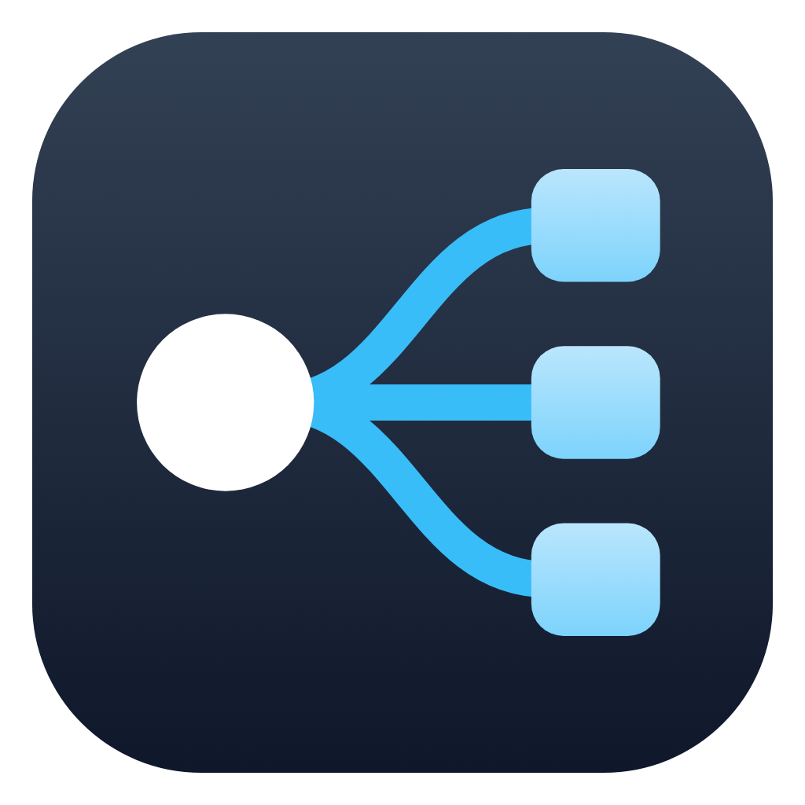

# Data Syncer

**An on-demand, one-way backup and sync tool for the Mac.** You pick a folder on your Mac as the
source of truth and one or more places to copy it to — another folder, a USB drive, a network
share, Google Drive, Amazon S3, an SSH server, iCloud Drive, Dropbox or OneDrive — and run it when
you want. Nothing runs in the background, nothing is kept in sync behind your back: it copies when
you press Run.



Three ways to copy, chosen per destination:

- **Sync** — the destination is made to match the source (with a preview first, and a per-job
  switch for whether files the source no longer has are deleted).
- **Full only** — every run makes a new dated folder holding a complete copy:
  `2026_10_20_1432_Full_<title>`.
- **Full + incremental** — dated full backups and incrementals that hold only what changed since
  the last one (or since the last full — your choice), with a limit on incrementals per chain.
  Restore puts a chain back in order, up to the point you pick.

Every copy is plain files you can open in Finder. Beside them, a small hidden `.datasyncer` folder
holds the records that let Data Syncer make incrementals and restore — so the backups describe
themselves, and another Mac can use them.

## Status

Built step by step. **Done:** step 1, the core (jobs, destinations, the scanner, sync, full and
incremental backups, the records, restore and the pre-run checks) and step 2, the windows
(the main window, job and destination editors, Check destinations, the run screen with the sync
preview, Settings, notifications) and step 3, restore (pick a destination and a backup, restore the
chain into a folder, delete old backups) and step 4, network shares (already connected, or connected
by the app) and SSH servers through the Mac's own `ssh`, step 5, the cloud services (Amazon S3 and
S3-compatible, Google Drive, Dropbox, OneDrive, with in-app setup guides), and step 6, appearance
(accent colours, named themes) and polish, followed by a deep review that fixed ~45 findings (data
safety first: nothing is deleted under an unreadable source folder, nothing is written through a
link, a half-copied file never replaces a good one, case-only renames keep the file). **Version
0.9.1, 69 tests; the next thing is real-world testing.** The cloud code is tested against fakes only
so far — see Docs/DEVELOPMENT.md.

## Quick start

```bash
./INSTALL_APP.sh                   # checks for Swift, runs the tests, builds Data Syncer.app, copies it to /Applications
./INSTALL_APP.sh --to ~/Desktop    # same, but put the app on the Desktop instead
./INSTALL_APP.sh --skip-tests      # run it again after pulling new code: rebuilds and replaces the app
./INSTALL_APP.sh --universal       # one app for Apple-silicon and Intel Macs (to copy to another Mac)
```

The finished `Data Syncer.app` can be copied to any other Mac running macOS 14 or newer and opened
there; see [Docs/SCRIPTS.md](Docs/SCRIPTS.md) for the one-time "Open Anyway" step, the chip question,
and how to keep Full Disk Access across rebuilds. `BUILD_APP.sh` is for development only.

**Requirements:** macOS 14 or newer and Xcode's command-line tools (`INSTALL_APP.sh` offers to
install them).

## Documentation

| | |
| --- | --- |
| [Docs/USER_GUIDE.md](Docs/USER_GUIDE.md) | Using the app: jobs, destinations, running, settings. |
| [Docs/ARCHITECTURE.md](Docs/ARCHITECTURE.md) | How it is built: the core's parts, what a run does, the storage interface every destination implements. |
| [Docs/RECORDS.md](Docs/RECORDS.md) | What Data Syncer writes beside your copies, backup folder names, chains, and what deleting a backup does. |
| [Docs/SCRIPTS.md](Docs/SCRIPTS.md) | `INSTALL_APP.sh`, `BUILD_APP.sh`, the icon script. |
| [Docs/DEVELOPMENT.md](Docs/DEVELOPMENT.md) | Building, tests, conventions. |
| [CHANGELOG.md](CHANGELOG.md) | What changed, when. |
| [CLAUDE.md](CLAUDE.md) | Notes for an AI assistant working on this code. |
